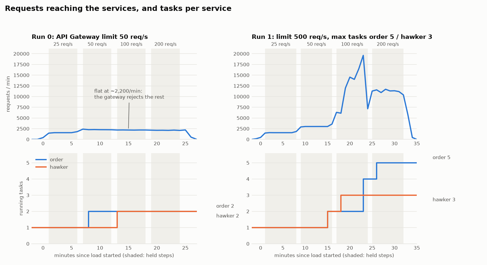
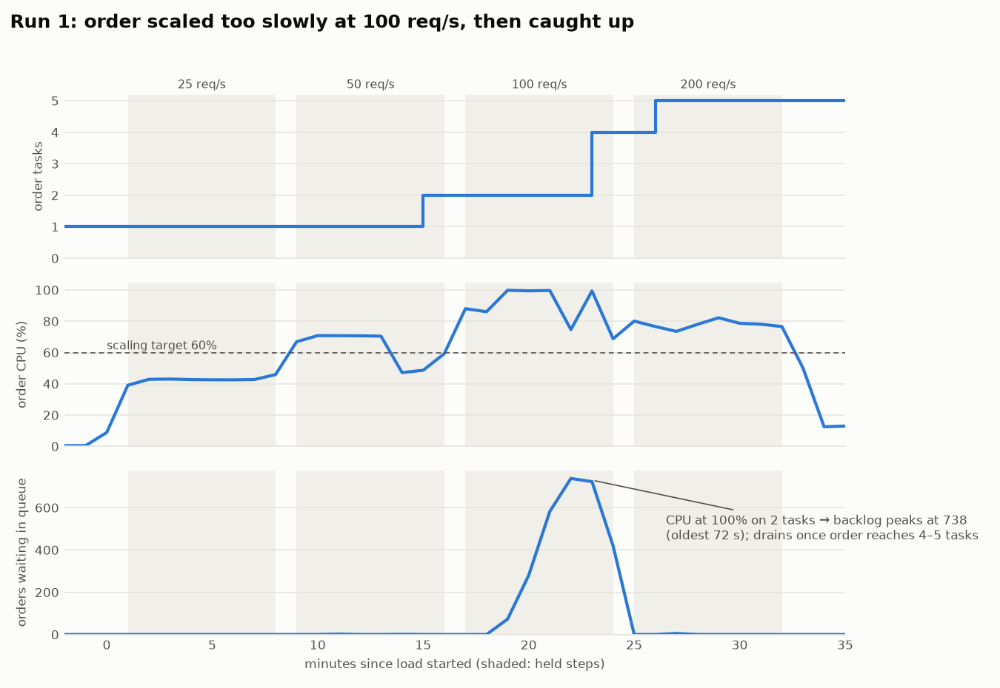

# Scalability: load testing and auto-scaling

Draft for the project report (Part A) and presentation (Part B). Based on load test runs 0 and 1 (17–18 Oct 2026). Evidence: [`evidence/INDEX.md`](../evidence/INDEX.md). Concepts and method detail: [`LOAD_TESTING_GUIDE.md`](LOAD_TESTING_GUIDE.md).

---

# Part A: report section

## 1. Requirement

The proposal commits to a workload model of **~40 requests/s at the lunch peak**, proven by **stepped load tests at 25, 50 and 100 requests/s**, with **auto-scaling evidence** and a **USL fit for headroom**. The platform was built on ECS Fargate, RDS PostgreSQL and SQS rather than the proposed Lambda/DynamoDB, so elasticity is measured as ECS task count.

## 2. Method

| | |
|---|---|
| Tool | k6, open model (fixed arrival rate), run from GitHub Actions ([hawkerflow-qa](../.github/workflows/load-test.yml)) |
| Workload | 70% browse (`GET /hawker/v1/hawker/stalls`), 30% checkout: post the order to the SQS queue route, then poll every 0.5 s until it is created (as the diner app does) |
| Steps | 25 → 50 → 100 → 200 user requests/s, each held 5 min (run 0) / 7 min (run 1) |
| SLOs (steps ≤ 50) | browse p95 < 300 ms, order placement p95 < 500 ms, errors < 1%, order end-to-end p95 < 10 s |
| Test data | a dedicated stall; orders auto-cancel after 15 min |
| Measured | k6 per-step results; CloudWatch: ECS tasks and CPU, load balancer requests and latency, queue backlog, RDS CPU and connections |

Path: diner → API Gateway → internal load balancer → ECS services → RDS; orders go API Gateway → SQS → order worker → RDS. Steps of 25 and 50 bracket the peak; 100 is the proposal's 2.5× headroom step; 200 looks for the limit. Steps above 50 are observation-only: they are expected to degrade.

## 3. Run 0: the bottleneck was the API Gateway

| Offered (req/s) | Achieved | Rejected at the gateway |
|---|---|---|
| 25 | 26 | 0% |
| 50 | 40 | **19%** |
| 100 | 46 | **54%** |
| 200 | 48 | **76%** |

API Gateway was throttled at **50 requests/s for the whole API**. Requests reaching the services flattened at ~2,200/min while offered load kept doubling (Figure 1, left). Because each order adds polls, even the 50 req/s step exceeded the limit: **as configured, the platform could not serve its own lunch peak**. The services themselves were not stressed (load balancer p95 ≈ 12 ms, RDS ≤ 12% CPU).

**Changes before run 1** (Terraform):
- API Gateway limit **50 → 500 requests/s** (burst 100 → 1,000), as variables.
- Maximum tasks **order 3 → 5, hawker 2 → 3**: hawker had reached its maximum even under the gateway cap.

*Figure 1. Requests reaching the services (top) and running tasks (bottom). Run 0 is capped by the gateway; in run 1 load reaches the services and both scale out.*

## 4. Run 1: results

| Offered (req/s) | Achieved (req/s) | Orders/s | Gateway 429s | Order end-to-end p95 | Browse p95 (client) | Server latency (mean) | Tasks |
|---|---|---|---|---|---|---|---|
| **25** | 26 | 8 | 0 | **1.0 s** | 236 ms | 6 ms | order 1, hawker 1 |
| **50** | 50 | 15 | 0 | **1.0 s** | 242 ms | 10 ms | order 1 → 2, hawker 1 → 2 |
| 100 | 97 | 26 | 0 | 52 s | 250 ms | 1.5 s | order 2 → 4, hawker 2 → 3 (max) |
| 200 | 189 | 60 | 0 | 1.1 s | 14.3 s | 2.9 s | order 4 → 5 (max), hawker 3 (max) |

**Requirement met at the peak.** At 25 and 50 requests/s every SLO passed, with no errors and orders created in ~1 s. No request was rejected by the gateway at any step.

**Elastic.** Hawker scaled 1 → 3 and order 1 → 5, each **~6 minutes after its CPU crossed the 60% target** (Figure 1, right).

**Overload behaviour (observation steps):**
- **At 100 requests/s, order scaled too slowly.** Its CPU stayed at 100% on two tasks for about four minutes before more tasks arrived. Orders queued (backlog **738**, oldest **72 s**), end-to-end p95 rose to **52 s**, and 410 orders exceeded the client's 60 s poll limit. Waiting diners kept polling, so gateway traffic reached **240 calls/s for 97 requests/s of useful work** (~5 polls per order). Once order reached 4–5 tasks the backlog drained completely (Figure 2).
- **At 200 requests/s, hawker hit its task maximum** (3 tasks, ~90% CPU) and browse p95 rose to 14 s. k6 could not start 5,814 browse iterations because its virtual users were all waiting on slow responses.

**The queue design held.** Order *placement* p95 stayed at ~237 ms at every step, including the worst of the backlog: diners are accepted immediately while order *creation* absorbs the surge and catches up.

**The database was not the bottleneck:** peak 45% CPU and 15 connections.

*Figure 2. Run 1, order service: tasks, CPU against its 60% scaling target, and the order queue backlog.*

## 5. Capacity and headroom

- **SLOs are met at 50 requests/s (1.25× the 40 req/s peak)** with automatic scale-out.
- **Throughput is sustained to ~190 requests/s (4.7×)**, with degraded latency beyond 50–100 requests/s: order end-to-end during scale-out, browse at hawker's task maximum.
- **The throughput limit was not reached** in the tested range.

**USL fit:** σ = 0.146, κ = 0, R² = 0.57 (ceiling ~178 requests/s). The fit is weak and is not used as the headroom figure: once queues build, server latency rises sharply, which the USL handles poorly under an open-model test. Plateaus throttled by the gateway (all of run 0) are excluded from fitting.

## 6. Lessons

1. **Check configuration before testing.** The gateway limit capped the API below its requirement; reading the Terraform predicted it, and run 0 confirmed it at low cost.
2. **Measure before tuning.** The scaling targets were template defaults; run 1 shows where they work (≤ 50 req/s) and where they are too slow (step to 100).
3. **Scale-out takes ~6 minutes.** Load that rises faster than that builds a queue; earlier triggers or larger tasks are needed for sharp increases.
4. **Polling multiplies load under backlog** (~5 polls per order at 100 req/s). Client back-off would reduce it.
5. **Validate the test itself.** The test harness was corrected to keep polling on 429, fail on dropped iterations, use server-side latency for concurrency, and exclude throttled steps from the fit.

## 7. Limitations

- Diner-side workload only: the hawker point-of-sale flow, logins, customer and analytics services were not exercised.
- Client latency includes ~220 ms of network between the GitHub runner and Singapore; server latency is reported separately.
- One run per configuration. Order CPU at 25 req/s differed between runs (68% in run 0, 43% in run 1); repeats would quantify the variance.
- Step changes are abrupt compared with a real lunch build-up; the database is a burstable instance (CPU credits) and long tests may behave differently.

## 8. Next steps

1. **Faster order scaling:** 0.5 vCPU order tasks and/or a lower CPU target (e.g. 50%).
2. **Hawker maximum 3 → 5**, keeping database connections in view (15 of ~80–110 used).
3. **Diner app poll back-off** (1 → 2 → 4 s).
4. **Run 2** with these changes to verify the 100 req/s step meets its SLOs; finer steps between 100 and 200 to locate the knee.
5. **Production gateway limit** set just above proven capacity (e.g. 150 req/s), raised only for test windows.

---

# Part B: presentation (scalability segment, 5 slides)

### Slide 1: What we had to prove
- ~40 requests/s at lunch; stepped tests at 25 / 50 / 100 req/s
- Auto-scaling evidence; headroom
- k6 from GitHub Actions → API Gateway → ECS → RDS (orders via SQS)

*Notes:* "Our proposal commits to a lunch-peak workload of about 40 requests per second. We tested in steps up to 200, measuring both what the user sees and what the servers do."

### Slide 2: Run 0, the first bottleneck wasn't our code
- Gateway limit 50 req/s for the whole API → **19% rejected at 50 req/s**
- Requests to the services flat at ~2,200/min while load doubled
- Fix: limit 500 req/s; more tasks allowed (order 5, hawker 3)
- *Figure 1, left*

*Notes:* "The first run showed the API Gateway rejecting requests before our services saw them. With order polling, even our lunch peak exceeded the limit, so the configuration, not the code, was the first bottleneck."

### Slide 3: Run 1, requirement met and the system scales
- 25 and 50 req/s: **all SLOs met**, orders created in ~1 s, servers answer in 6–10 ms
- Hawker 1 → 3, order 1 → 5 tasks, ~6 min after the CPU target
- No requests rejected at any step
- *Figure 1, right, plus the results table*

*Notes:* "With the gateway out of the way, the lunch-peak steps met every target and both services scaled out automatically."

### Slide 4: Beyond the peak, the queue absorbs the surge
- 100 req/s: order scaled too slowly → backlog 738, end-to-end 52 s; drained once 4–5 tasks ran
- Order **placement stayed ~237 ms** throughout: diners never waited to be accepted
- 200 req/s: hawker at its task maximum, browse 14 s
- *Figure 2*

*Notes:* "This is the queue design working: under 2.5× load, accepting an order stayed instant while creating it caught up once capacity arrived."

### Slide 5: Capacity, lessons, next steps
- SLOs met at ≥ 1.25× peak; throughput sustained to ~190 req/s (4.7×) with degraded latency
- Lessons: check configuration first; measure before tuning; scale-out takes ~6 min; polling multiplies load
- Next: larger order tasks / earlier trigger, hawker max 5, client poll back-off, verify with run 2

*Notes:* "We meet the requirement with margin, we know the two limits beyond it and why, and the next changes follow directly from the data."
